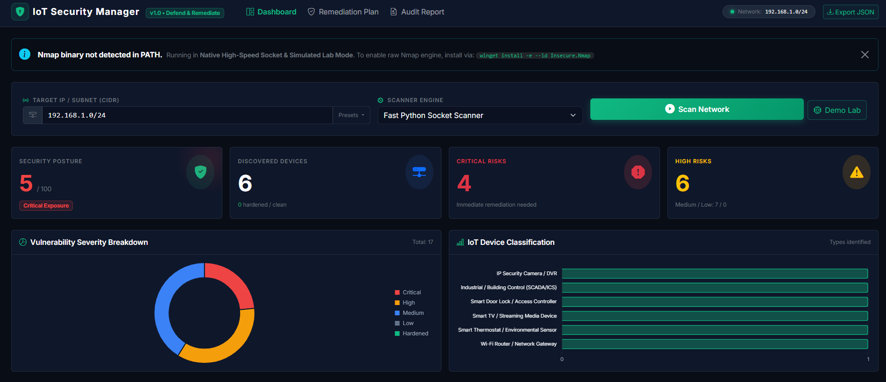

# 🛡️ IoT Device Security Manager

An enterprise-grade, lightweight web application developed with **Python**, **Nmap**, and **Flask** designed to discover IoT devices on a network, interrogate open services, identify security vulnerabilities and known CVEs, and generate prioritized, actionable mitigation steps.


)
---

## 🚀 Key Features

- **Multi-Engine Scanning**:
  - **Nmap Scanner (`python-nmap`)**: Deep port scanning and service detection using Nmap.
  - **Fast Native Socket Scanner**: High-speed, multi-threaded pure Python fallback requiring zero external binary dependencies or elevated raw socket privileges.
  - **Virtual IoT Lab Mode**: Built-in simulated network featuring authentic, vulnerable IoT targets (Hikvision IP Camera, Smart Thermostats, Smart Locks, Gateway Routers, Industrial BACnet/Modbus PLCs) for immediate demonstration and academic grading.
- **Intelligent IoT Fingerprinting**: Classifies devices (IP Cameras, Smart Hubs, Thermostats, Smart Locks, Media Devices, Routers, Industrial IoT) using MAC OUI manufacturer database, banners, and signature heuristics.
- **Vulnerability & CVE Assessment Engine**:
  - Unencrypted protocols (Cleartext Telnet on Port 23, plaintext MQTT on Port 1883).
  - Unauthenticated RTSP video streams (Port 554).
  - Exposed UPnP / SSDP vulnerabilities (*CallStranger* CVE-2020-12695).
  - High-impact CVEs (*Hikvision RCE* CVE-2021-36260, *GoAhead RCE* CVE-2017-17562, *RomPager Misfortune Cookie* CVE-2014-9222).
  - Factory default credential exposure and missing HTTPS encryption.
- **Actionable Mitigation Generator**:
  - Step-by-step remediation plans per vulnerability with prioritized urgency levels (P0, P1, P2).
  - Ready-to-use configuration commands (e.g., Mosquitto TLS configuration, OpenWrt service toggles).
  - Firewall defense rules (`iptables` and router rules).
  - Strategic architecture hardening guides (IoT VLAN segmentation, guest network isolation, UPnP lockdown).
- **Interactive Cyber Dark Dashboard**: Real-time progress tracking, Network Security Posture Gauge (0-100), Chart.js severity breakdown, device inventory filtering, and interactive remediation checklists.
- **Comprehensive Audit Reporting**: Exportable JSON assessment reports and print-ready executive security audit reports for management or evaluation.

---

## 🛠️ Tech Stack

- **Backend**: Python 3.12+, Flask 3.1, `python-nmap`, `requests`, `concurrent.futures`
- **Scanning**: Nmap / Python Non-blocking Concurrent Sockets
- **Frontend**: HTML5, CSS3, JavaScript (ES6+), Bootstrap 5, Bootstrap Icons, Chart.js

---

## 📁 Project Structure

```
IoT Device Security Manager/
├── app.py                      # Flask main controller & background scan manager
├── config.py                   # Port mappings, timeout settings, and configurations
├── requirements.txt            # Python dependencies
├── test_scanner.py             # Automated unit and integration test suite
├── README.md                   # Project documentation
├── scanner/                    # Discovery & scanning engine
│   ├── __init__.py
│   ├── network_detector.py     # Local IP, subnet CIDR, and ARP table detection
│   ├── socket_engine.py        # Concurrent multi-threaded Python socket scanner
│   ├── nmap_engine.py          # Python-Nmap scanner wrapper & binary discovery
│   ├── iot_fingerprint.py      # OUI MAC lookup & heuristic device categorization
│   └── mock_network.py         # Virtual IoT Lab simulation environment
├── analyzer/                   # Vulnerability & mitigation intelligence
│   ├── __init__.py
│   ├── cve_database.py         # Curated IoT CVEs, CVSS 3.1 scores, and rules
│   ├── vulnerability_engine.py # Severity evaluator & network security posture scoring
│   └── mitigation_generator.py # Step-by-step remediation guides & firewall rules
├── reports/                    # Reporting & data export
│   ├── __init__.py
│   └── report_generator.py     # JSON and printable executive audit summary builder
├── static/                     # Frontend static assets
│   ├── css/
│   │   └── style.css           # Cyber dark theme with neon accents
│   └── js/
│       ├── app.js              # Scan controller, AJAX polling, search filters
│       └── charts.js           # Chart.js doughnut and bar charts
└── templates/                  # Jinja2 HTML templates
    ├── base.html               # Master layout with navigation and live status
    ├── index.html              # Main dashboard with stats, charts, and device grid
    ├── device_detail.html      # In-depth per-device vulnerability & mitigation view
    ├── mitigations.html        # Consolidated interactive remediation checklist
    └── report_template.html    # Print-friendly executive audit report
```

---

## ⚡ Quick Start

### 1. Install Dependencies
```bash
pip install -r requirements.txt
```

### 2. Run the Application
```bash
python app.py
```

Open your browser and navigate to:
```
http://127.0.0.1:5000
```

---

## 🔍 How to Use

1. **Dashboard Overview**: The dashboard automatically loads the current assessment status.
2. **Launch a Network Scan**:
   - The app auto-detects your local network subnet (e.g., `192.168.1.0/24`).
   - Select your scanning engine:
     - **Fast Python Socket Scanner**: Instant scanning of standard IoT ports.
     - **Nmap PortScanner**: Runs full Nmap interrogation (if installed).
     - **Virtual IoT Lab**: Loads a realistic simulation of 6 diverse IoT devices with authentic vulnerabilities.
   - Click **"Scan Network"** or **"Demo Lab"**.
3. **Inspect Devices**:
   - Filter devices by IP, name, vendor, or severity level in the inventory table.
   - Click **"Inspect & Fix"** on any device to view open ports, banners, and tailored mitigation steps.
4. **Remediate Vulnerabilities**:
   - Navigate to the **"Remediation Plan"** tab.
   - Follow prioritized step-by-step instructions and apply configuration snippets.
   - Check off resolved items; progress is saved automatically.
5. **Generate & Export Reports**:
   - Click **"Audit Report"** to view and print/save a PDF audit report.
   - Click **"Export JSON"** to download the raw assessment payload.

---

## ⚙️ Enabling Real Nmap (Optional on Windows)

The application includes an ultra-fast built-in Python socket scanner that works out of the box without Nmap. If you wish to enable the raw Nmap engine:

Open PowerShell (as Administrator) and run:
```powershell
winget install -e --id Insecure.Nmap
```
Once installed, restart the Flask app. The banner will confirm Nmap is detected and ready.

---

## 🧪 Running Automated Tests

Run the included test suite to verify all modules:
```bash
python test_scanner.py
```
Outputs:
```
Ran 6 tests in 0.084s
OK
```

---

## 🔒 Security Disclaimer
This tool is designed for authorized network security assessments, defensive monitoring, and educational purposes. Always ensure you have explicit authorization before scanning networks and devices.
